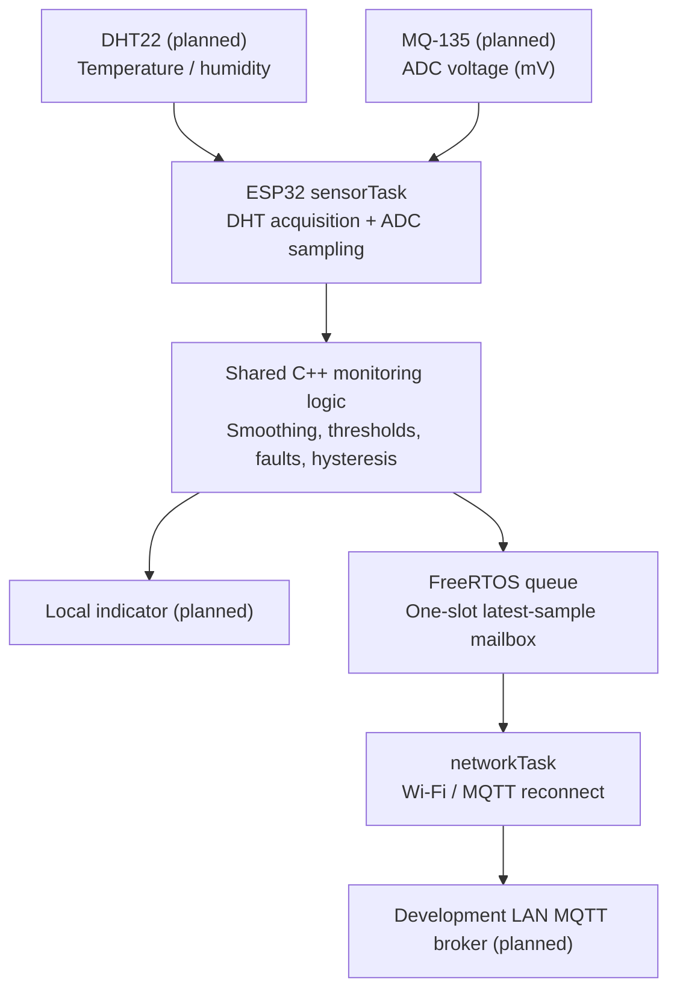

# System Architecture

> **Status:** Software-only prototype. This diagram documents the proposed ESP32 firmware architecture, not a physically validated circuit.

## Data flow

1. `sensorTask` samples DHT22 and the ESP32 ADC every 2 seconds.
2. Shared monitoring logic applies exponential smoothing (alpha 0.25), a 60-second startup gate, fault checks and alert hysteresis.
3. The sensor task overwrites a one-element FreeRTOS mailbox with the newest result. This is **not** a historical event queue.
4. `networkTask` consumes the latest result and attempts MQTT publication over Wi-Fi. Wi-Fi retry is 10 seconds and MQTT retry is 5 seconds; stale readings older than 10 seconds are discarded.
5. The local indicator reflects the monitoring state.

## Scope and limitations

- The native C++ simulator and state-logic tests run without hardware.
- The ESP32 firmware is an **uncompiled hardware integration draft**; physical sensors, LED and broker have not been validated.
- MQ-135 is represented as **ADC millivolts**, not calibrated CO2, ppm or AQI.
- MQTT uses QoS 0 in the proposed firmware. Publication success does not guarantee delivery.
- The proposed plaintext MQTT setup is for a trusted development LAN only, not public deployment.
- See [wiring.md](wiring.md), [validation.md](validation.md), and the root [README](../README.md) for details.
