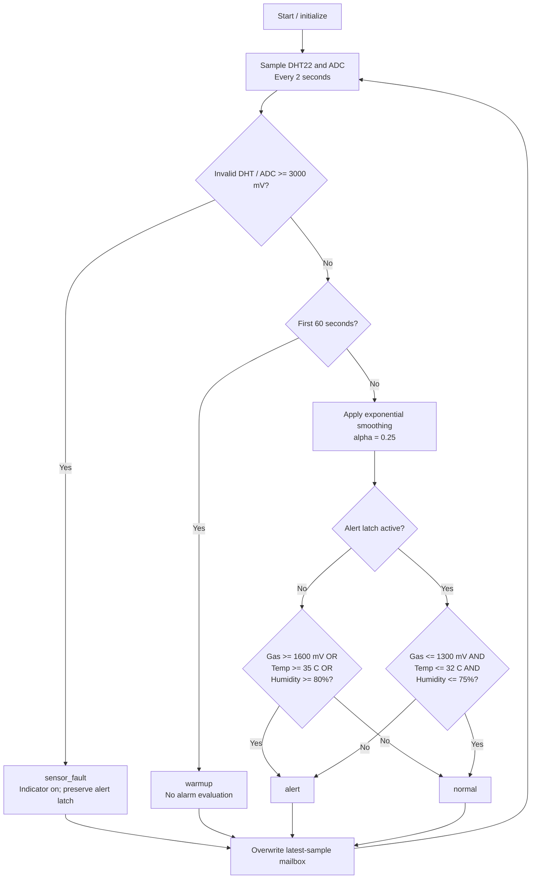
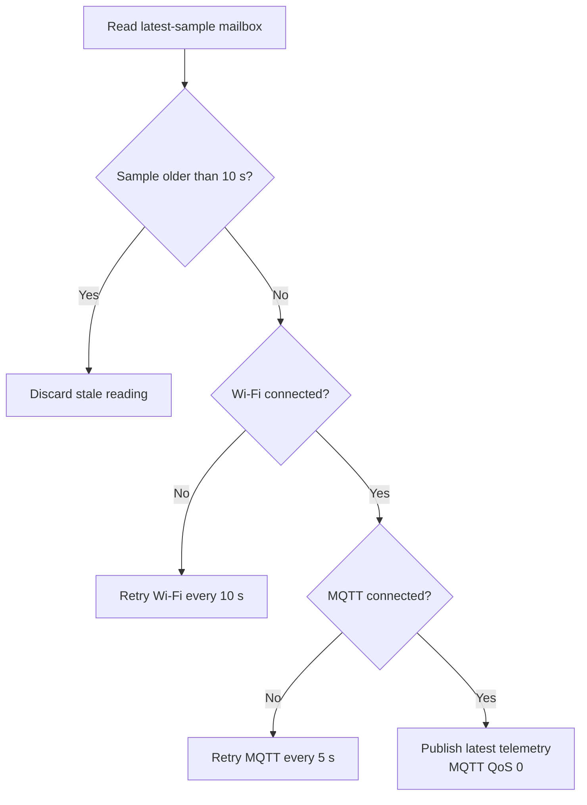

# Firmware Monitoring Flow

> **Status:** Documentation of the software prototype and proposed ESP32 integration. Not evidence of hardware testing.

## Separate network task

## Important notes

- The 60-second startup gate is a **software state-machine exercise**, not MQ-135 sensor burn-in or calibration.
- Thresholds are demonstration values, not safety limits.
- A fault overrides the displayed alert state but does not reset the alert latch.
- Zero ADC voltage is not automatically classified as an open-wire fault.
- The native simulator advances 120 samples at 2-second **logical** intervals; it is not real-time measurement.
- Refer to [validation.md](validation.md) for what has actually been tested.
